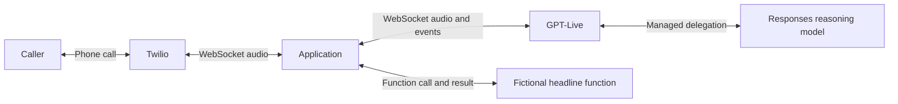
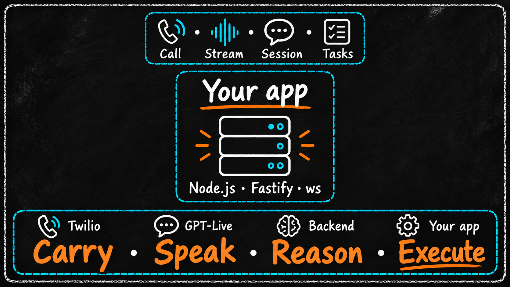
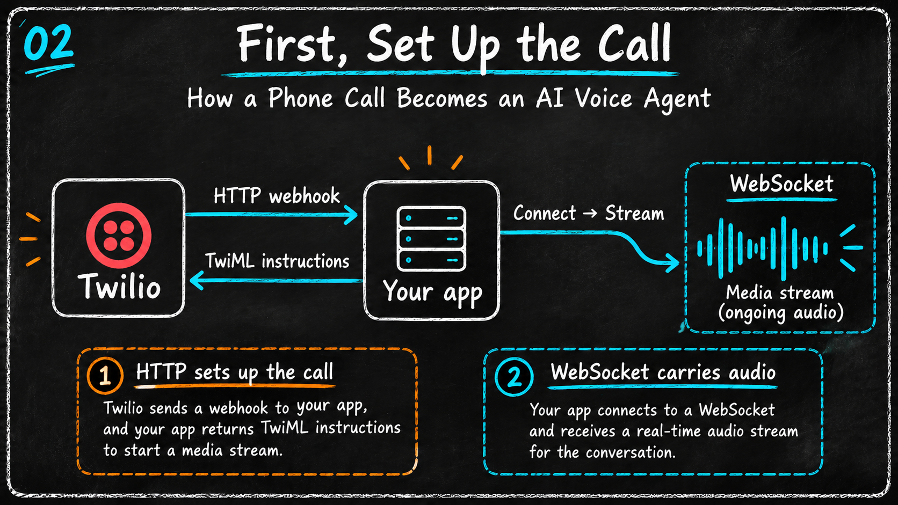
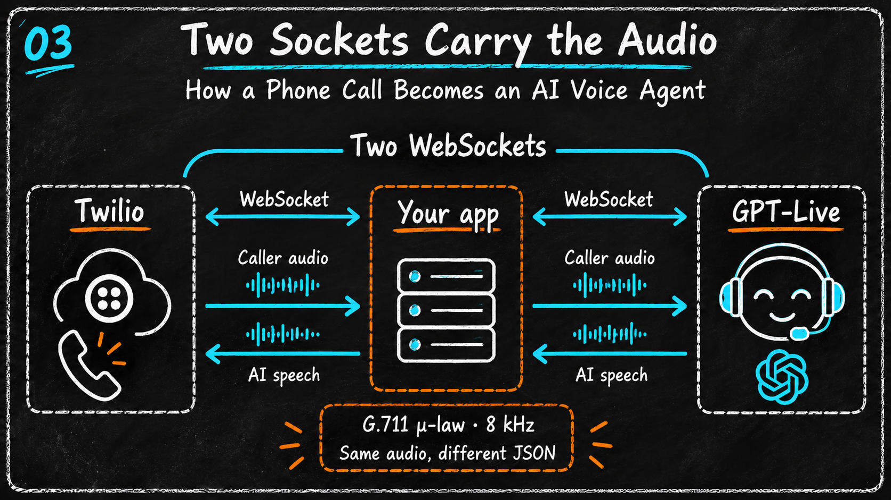
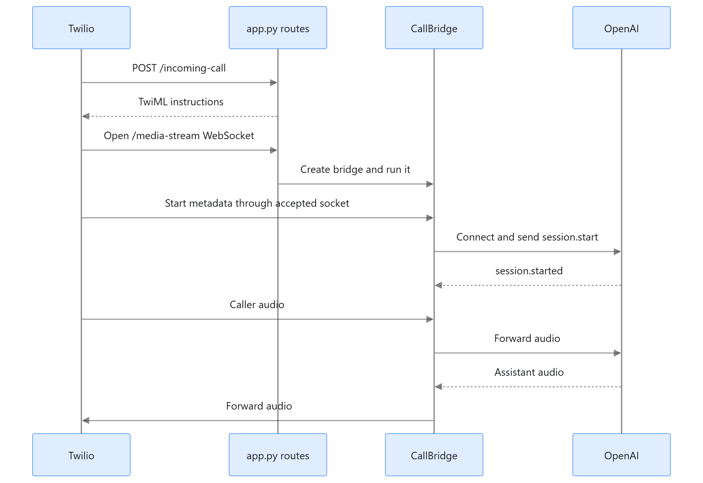

# Inbound Only GPT-Live Twilio Call — Python AI voice assistant

An inbound phone assistant with an explicit audio bridge, a delegated reasoning
model, hosted web search, and one **fictional** headline function. Python makes
the protocol easy to annotate; the architecture does not depend on the framework.

The diagrams below explain the component responsibilities and call flow. Follow
the setup and testing steps to run the project. [The code walkthrough](docs/WALKTHROUGH.md)
covers the implementation in detail, and [the source notes](docs/SOURCES.md) list
the API references and verification scope.

## How it works



### 1. Understand who carries, speaks, reasons, and executes



> **Implementation:** the illustration shows alternative application stacks.
> This repository uses **Python, FastAPI, and websockets**.

| Component | Responsibility in this project |
| --- | --- |
| **Twilio — carry** | Connect the phone caller and transport audio through Media Streams. |
| **GPT-Live — speak** | Handle the voice interaction and delegate requests needing reasoning or tools. |
| **Delegated Responses model — reason** | Handle delegated work, including choosing the fictional function or optional hosted web search. |
| **Your application — execute** | Validate requests, bridge audio, run the local function, return its result, and clean up each call. |

The **Call → Stream → Session → Tasks** labels describe related pieces of one
conversation: Twilio's call and stream IDs, the OpenAI voice session, and local
asynchronous tasks. Each caller gets a separate `CallBridge` in
[bridge.py](bridge.py). OpenAI manages the delegated reasoning connection; the
application opens the voice connection and handles its events.

### 2. Set up the call with HTTP and TwiML



1. Someone calls your Twilio number. Twilio sends an HTTP
   `POST /incoming-call` to the application.
2. [app.py](app.py) validates the Twilio signature and returns **TwiML**, XML
   containing `<Connect><Stream url="wss://…/media-stream" /></Connect>`.
3. Twilio follows those instructions and opens a **WebSocket to the application's
   `/media-stream` endpoint**. The application validates that request before
   accepting the connection.

The HTTP response provides instructions; the continuing WebSocket carries audio
in both directions. In the illustration, “Connect → Stream” represents the TwiML
instruction: **Twilio initiates this media connection to your app**. Your app
separately opens the connection to GPT-Live in the next step.

### 3. Bridge audio through two WebSockets



The two connections are **Twilio ↔ application** and **application ↔ GPT-Live**.
They carry caller audio toward the model and generated speech back toward the
caller. The app translates the event envelopes at each boundary:

| Direction | Audio field |
| --- | --- |
| Twilio → application | `event: media` with `media.payload` |
| Application → GPT-Live | `type: session.input_audio.append` with `audio` |
| GPT-Live → application | `type: session.output_audio.delta` with `delta` |
| Application → Twilio | `event: media` with `streamSid` and `media.payload` |

Both sides use **mono G.711 μ-law (PCMU) at 8 kHz**, so this bridge preserves the
base64 audio payload while changing its JSON envelope. `read_twilio()` and
`read_openai()` in [bridge.py](bridge.py) run concurrently. Local function work
runs as a separate task so its simulated delay does not block audio forwarding.

### 4. Follow the sequence in the Python code



Read this diagram **from top to bottom**:

1. **Route and bridge:** after the signed webhook and media connection,
   `media_stream()` creates and runs one `CallBridge` for that caller.
2. **Stream metadata:** `wait_for_twilio_start()` reads Twilio's `start` event,
   checks the codec, and records the call and stream IDs.
3. **Voice session:** the bridge connects to OpenAI and sends `session.start`.
   After `session.started`, it requests the greeting and forwards caller audio.
   Audio received before readiness is discarded in this demo.
4. **Conversation:** the two readers forward caller audio and AI speech for the
   duration of the connection.

The sequence image focuses on startup and audio. Two more paths complete the
implementation:

- **Function result:** a completed function-call item arrives inside
  `response.event`. `execute_tool()` runs the fictional headline function, sends
  `response.item.create` with its output, then sends `response.create` to continue
  the delegated work. Hosted web search is executed by OpenAI.
- **Hangup and cleanup:** the bridge cancels caller-input and local tool tasks.
  When the voice session is ready and its receiver is still active, it requests
  `session.close`, waits within a timeout for `session.closed`, and releases the
  transports. A disconnected socket alone does not confirm final usage.

These diagrams explain the implementation. The offline tests check event routing
and cleanup; actual phone audio, model access, and interruption behavior still
require the real-call checks in Step 4 below.

## Step 1 — Learn the files and configuration

| File | Purpose |
| --- | --- |
| `config.py` | Reading `.env`, separate model settings, and the public origin. |
| `demo_tools.py` | Prompts, JSON Schema, session configuration, and the fake tool. |
| `app.py` | HTTP webhook, TwiML, signatures, and the media WebSocket route. |
| `bridge.py` | Per-call state, concurrent audio readers, function results, cleanup. |
| `tests/test_demo.py` | The real bridge running against fake provider sockets. |
| `docs/WALKTHROUGH.md` | Call lifecycle and implementation details. |

Use Python **3.11 or later**. The local verification used Python 3.14 on Windows.
Clone the repository, then create a local environment in PowerShell:

```powershell
git clone https://github.com/aymalkhalid/Inbound-Only-GPT-Live-Twilio-Call.git
cd Inbound-Only-GPT-Live-Twilio-Call
python -m venv .venv
.\.venv\Scripts\python.exe -m pip install -r requirements-lock.txt
if (-not (Test-Path .env)) { Copy-Item .env.example .env }
```

`requirements-lock.txt` pins the complete tested environment, including
test dependencies. `requirements.txt` and `requirements-dev.txt` describe the
direct runtime and test dependencies if you deliberately want to resolve them anew.

The application reads the `.env` **next to `config.py`**, regardless of the shell's
working directory. Existing process environment variables take priority.
Fill in your credentials and tunnel origin in the local `.env`. Use `.env.example`
as a reference; do not copy it over an existing file containing your credentials.
The repository excludes `.env`, virtual environments, and local editor settings.

| Setting | Meaning / default |
| --- | --- |
| `OPENAI_API_KEY` | OpenAI API key; used only on the server. |
| `TWILIO_AUTH_TOKEN` | Token for the account owning the incoming number; validates requests. |
| `PUBLIC_BASE_URL` | Your public HTTPS origin, for example `https://example.ngrok-free.app`. |
| `LIVE_MODEL` | Voice model; defaults to `gpt-live-1`. |
| `DELEGATED_MODEL` | Reasoning model; defaults to the tutorial's `gpt-5.6-terra`. |
| `VOICE` | Defaults to `marin`. |
| `ENABLE_WEB_SEARCH` | `true` by default; use `false` to omit the hosted search tool. |
| `TOOL_DELAY_SECONDS` | Defaults to `2`, demonstrating a slow asynchronous tool. |
| `STARTUP_TIMEOUT_SECONDS` | Defaults to `15`. |
| `CLOSE_TIMEOUT_SECONDS` | Defaults to `5`; bounds graceful finalization. |

`OPENAI_MODEL` is unused. Configure the voice and reasoning models separately with
`LIVE_MODEL` and `DELEGATED_MODEL`. `TWILIO_ACCOUNT_SID` and `TWILIO_PHONE_NUMBER`
are also unused: the application receives inbound calls through the configured
webhook and does not use the Twilio REST API to place calls or update the number.

## Step 2 — Run the offline checks

```powershell
.\.venv\Scripts\python.exe -m unittest discover -s tests -v
```

The tests inject fake credentials and fake sockets. They do not load your `.env`,
call providers, create a tunnel, or spend API credits. They check signed TwiML,
unauthorized-request rejection, audio envelope translation, delayed-tool
concurrency, duplicate-call suppression, startup timeout, and cleanup.

## Step 3 — Start the local server

```powershell
.\.venv\Scripts\python.exe -m uvicorn app:create_app --factory --host 127.0.0.1 --port 5050
```

In another terminal:

```powershell
Invoke-RestMethod http://127.0.0.1:5050/
```

Expected fields are `status: ok` and `demo: Twilio GPT-Live audio bridge`. This is a
liveness check only. It does not verify credentials, model access, or phone audio.
Starting the server alone opens no OpenAI session. Stop it with **Ctrl+C**.

The application uses an app factory (`--factory`) so imports have no credential
or network side effects. Reloading during editing disconnects active calls.

## Step 4 — Connect an inbound phone call

This step exposes the local app through an HTTPS tunnel and uses paid
Twilio/OpenAI services.

1. Start an HTTPS tunnel to port 5050, for example with an installed ngrok client:

   ```powershell
   ngrok http 5050
   ```

2. Add the actual tunnel origin to your existing `.env`, without an endpoint path:

   ```dotenv
   PUBLIC_BASE_URL=https://your-actual-tunnel.ngrok-free.app
   ```

   Restart the local server after changing `.env`. If the tunnel hostname changes,
   update both `.env` and the Twilio webhook.

3. Verify that opening the public root URL returns the health response. A browser
   warning/login page is not a working Twilio webhook endpoint.

4. In Twilio Console, open **Phone Numbers → Manage → Active numbers → your
   voice-capable number → Voice configuration**. Set **A call comes in** to
   **Webhook**, using **HTTP POST** and:

   ```text
   https://your-actual-tunnel.ngrok-free.app/incoming-call
   ```

5. Call the number. Wait for the AI greeting, then try the checks below. Your
   OpenAI API project must have access to both configured models.

| Try saying | What it exercises | Evidence to look for |
| --- | --- | --- |
| “Hello. What is this demo?” | Two-way phone audio. | An audible, relevant response. |
| “Give me a fictional demo headline for Karachi.” | Delegation → local function → result → speech. | `Demo function completed`; spoken result labeled fictional. |
| “Search the web for today's weather in Karachi.” | Hosted web search, if enabled. | A relevant current answer; this minimal app doesn't render a citations UI. |
| “Count slowly to twenty,” then interrupt. | Listening while speaking across the full phone path. | Hear whether the assistant reacts promptly; measure this manually. |
| Hang up. | Session finalization and resource cleanup. | `final_usage_confirmed=True`, or an explicit incomplete-finalization warning. |

The greeting requests specific wording from the model; verify what was actually
spoken. This implementation does not guarantee word-for-word disclosure playback.

## Step 5 — Review capabilities and limitations

- The headline tool is deterministic **fictional data**, with no news API or real
  business integration. Its delay models I/O; it does not perform business work.
- Audio before `session.started` is discarded, following the source tutorial.
  Waiting for the greeting avoids relying on that early audio.
- The bridge passes Live's continuous audio through to Twilio. Provider playback
  queue control (`mark`/`clear`) and measured barge-in performance are future work.
  No Realtime `response.cancel` or VAD turn engine is assumed here.
- Transcripts and audio are not saved or printed by the application. Logs contain
  lifecycle identifiers, tool call IDs, and observed voice-duration snapshots.
  Those snapshots are **not** a complete Twilio/OpenAI cost report.
- Signatures are validated on both entry points. Rate limiting, durable action
  idempotency, spend limits, human transfer, and production recovery are outside
  this example. Canceling a local task would not undo a future external write.

Keep `.env` out of version control and shared project archives. A signed media
connection can open a billable Live session; keep the public tunnel limited to
your intentional testing period.

## Troubleshooting

| Symptom | Check |
| --- | --- |
| `503` on `/incoming-call` | Required credentials or `PUBLIC_BASE_URL` are missing/invalid. |
| `403` on the webhook/stream | Correct account Auth Token, exact public origin, POST method, and unchanged form fields. Unsigned curl requests are expected to fail. |
| Health works, call is silent | Look for `Live ready`; check model access, public WSS reachability, and the Twilio debugger. |
| `OpenAI session error code=...` | Check the named error and configured model/tool access. Raw error bodies are intentionally not logged. |
| Headline described as real news | Review the prompts and actual spoken result; it must be identified as fictional. |
| Hangup logs incomplete finalization | Network failure or close timeout; final usage is unconfirmed. |
