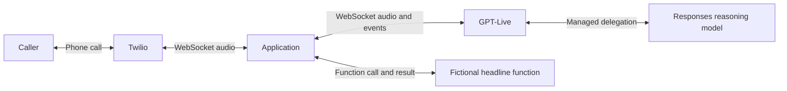

# Inbound Only GPT-Live Twilio Call — Python AI voice assistant

An inbound phone assistant with an explicit audio bridge, a delegated reasoning
model, hosted web search, and one **fictional** headline function. Python makes
the protocol easy to annotate; the architecture does not depend on the framework.

Read [the walkthrough](docs/WALKTHROUGH.md) alongside the source. Every application
module and function has a docstring, and comments explain the decisions at each
protocol boundary. [The source notes](docs/SOURCES.md) link the verified API docs.



## Step 1 — Learn the files and configuration

| File | What to study |
| --- | --- |
| `config.py` | Reading `.env`, separate model settings, and the public origin. |
| `demo_tools.py` | Prompts, JSON Schema, session configuration, and the fake tool. |
| `app.py` | HTTP webhook, TwiML, signatures, and the media WebSocket route. |
| `bridge.py` | Per-call state, concurrent audio readers, function results, cleanup. |
| `tests/test_demo.py` | The real bridge running against fake provider sockets. |
| `docs/WALKTHROUGH.md` | A teaching sequence from first request to final cleanup. |

Use Python **3.11 or later**. The local verification used Python 3.14 on Windows.
Clone the repository, then create a local environment in PowerShell:

```powershell
git clone https://github.com/aymalkhalid/Inbound-Only-GPT-Live-Twilio-Call.git
cd Inbound-Only-GPT-Live-Twilio-Call
python -m venv .venv
.\.venv\Scripts\python.exe -m pip install -r requirements-lock.txt
if (-not (Test-Path .env)) { Copy-Item .env.example .env }
```

`requirements-lock.txt` pins the complete tested environment, including
test dependencies. `requirements.txt` and `requirements-dev.txt` describe the
direct runtime and test dependencies if you deliberately want to resolve them anew.

The application reads the `.env` **next to `config.py`**, regardless of the shell's
working directory. Existing process environment variables take priority.
Fill in your credentials and tunnel origin in the local `.env`. Use `.env.example`
as a reference; do not copy it over an existing file containing your credentials.
The repository excludes `.env`, virtual environments, and local editor settings.

| Setting | Meaning / default |
| --- | --- |
| `OPENAI_API_KEY` | Existing key; used only on the server. |
| `TWILIO_AUTH_TOKEN` | Token for the account owning the incoming number; validates requests. |
| `PUBLIC_BASE_URL` | Your public HTTPS origin, for example `https://example.ngrok-free.app`. |
| `LIVE_MODEL` | Voice model; defaults to `gpt-live-1`. |
| `DELEGATED_MODEL` | Reasoning model; defaults to the tutorial's `gpt-5.6-terra`. |
| `VOICE` | Defaults to `marin`. |
| `ENABLE_WEB_SEARCH` | `true` by default; use `false` to omit the hosted search tool. |
| `TOOL_DELAY_SECONDS` | Defaults to `2`, demonstrating a slow asynchronous tool. |
| `STARTUP_TIMEOUT_SECONDS` | Defaults to `15`. |
| `CLOSE_TIMEOUT_SECONDS` | Defaults to `5`; bounds graceful finalization. |

An existing generic `OPENAI_MODEL` is deliberately unused. The voice and reasoning
models occupy different fields and require compatible APIs. Existing
`TWILIO_ACCOUNT_SID` and `TWILIO_PHONE_NUMBER` can remain in `.env`; this demo does
not use the Twilio REST API to place calls or update the number.

## Step 2 — Run the offline checks

```powershell
.\.venv\Scripts\python.exe -m unittest discover -s tests -v
```

The tests inject fake credentials and fake sockets. They do not load your `.env`,
call providers, create a tunnel, or spend API credits. They check signed TwiML,
unauthorized-request rejection, audio envelope translation, delayed-tool
concurrency, duplicate-call suppression, startup timeout, and cleanup.

On a restricted Windows agent sandbox, Python's asyncio loop can be blocked while
creating its internal loopback socket. Run the same checks in a regular local
terminal if the test runner stalls before executing the first test.

## Step 3 — Start the local server

```powershell
.\.venv\Scripts\python.exe -m uvicorn app:create_app --factory --host 127.0.0.1 --port 5050
```

In another terminal:

```powershell
Invoke-RestMethod http://127.0.0.1:5050/
```

Expected fields are `status: ok` and `demo: Twilio GPT-Live audio bridge`. This is a
liveness check only. It does not verify credentials, model access, or phone audio.
Starting the server alone opens no OpenAI session. Stop it with **Ctrl+C**.

The application uses an app factory (`--factory`) so imports have no credential
or network side effects. Reloading is optional during editing; a reload will
disconnect active calls, so leave it off during a demonstration.

## Step 4 — Connect a real phone call when ready

This step exposes the local app and uses paid Twilio/OpenAI services. It has not
been performed automatically. No phone-number configuration was changed.

1. Start an HTTPS tunnel to port 5050, for example with an installed ngrok client:

   ```powershell
   ngrok http 5050
   ```

2. Add the actual tunnel origin to your existing `.env`, without an endpoint path:

   ```dotenv
   PUBLIC_BASE_URL=https://your-actual-tunnel.ngrok-free.app
   ```

   Restart the local server after changing `.env`. If the tunnel hostname changes,
   update both `.env` and the Twilio webhook.

3. Verify that opening the public root URL returns the health response. A browser
   warning/login page is not a working Twilio webhook endpoint.

4. In Twilio Console, open **Phone Numbers → Manage → Active numbers → your
   voice-capable number → Voice configuration**. Set **A call comes in** to
   **Webhook**, using **HTTP POST** and:

   ```text
   https://your-actual-tunnel.ngrok-free.app/incoming-call
   ```

5. Call the number. Wait for the AI greeting, then try the checks below. The key's
   project must have access to both configured models; local presence of a key
   does not establish that access. Trial-account restrictions may also apply.

| Try saying | What it exercises | Evidence to look for |
| --- | --- | --- |
| “Hello. What is this demo?” | Two-way phone audio. | An audible, relevant response. |
| “Give me a fictional demo headline for Karachi.” | Delegation → local function → result → speech. | `Demo function completed`; spoken result labeled fictional. |
| “Search the web for today's weather in Karachi.” | Hosted web search, if enabled. | A relevant current answer; this minimal app doesn't render a citations UI. |
| “Count slowly to twenty,” then interrupt. | Listening while speaking across the full phone path. | Hear whether the assistant reacts promptly; measure this manually. |
| Hang up. | Session finalization and resource cleanup. | `final_usage_confirmed=True`, or an explicit incomplete-finalization warning. |

The greeting requests specific wording from the model; verify what was actually
spoken. This implementation does not guarantee word-for-word disclosure playback.

## Step 5 — Understand the demo's boundary before extending it

- The headline tool is deterministic **fictional data**, with no news API or real
  business integration. Its delay models I/O; it does not perform business work.
- Audio before `session.started` is discarded, following the source tutorial.
  Waiting for the greeting avoids relying on that early audio.
- The bridge passes Live's continuous audio through to Twilio. Provider playback
  queue control (`mark`/`clear`) and measured barge-in performance are future work.
  No Realtime `response.cancel` or VAD turn engine is assumed here.
- Transcripts and audio are not saved or printed by the application. Logs contain
  lifecycle identifiers, tool call IDs, and observed voice-duration snapshots.
  Those snapshots are **not** a complete Twilio/OpenAI cost report.
- Signatures are validated on both entry points. Rate limiting, durable action
  idempotency, spend limits, human transfer, and production recovery are outside
  this teaching demo. Canceling a local task would not undo a future external write.

Keep `.env` out of screen recordings and shared project archives. A signed media
connection can open a billable Live session; keep the public tunnel limited to
your intentional testing period.

## Troubleshooting

| Symptom | Check |
| --- | --- |
| `503` on `/incoming-call` | Required credentials or `PUBLIC_BASE_URL` are missing/invalid. |
| `403` on the webhook/stream | Correct account Auth Token, exact public origin, POST method, and unchanged form fields. Unsigned curl requests are expected to fail. |
| Health works, call is silent | Look for `Live ready`; check model access, public WSS reachability, and the Twilio debugger. |
| `OpenAI session error code=...` | Check the named error and configured model/tool access. Raw error bodies are intentionally not logged. |
| Headline described as real news | Review the prompts and actual spoken result; it must be identified as fictional. |
| Hangup logs incomplete finalization | Network failure or close timeout; final usage is unconfirmed. |

For a learner video, follow Steps 1–4 and explain each protocol boundary with the
walkthrough. For a potential-client demo, introduce one concrete workflow next
(such as a read-only availability lookup) and validate that workflow before
adding actions that modify client systems.
